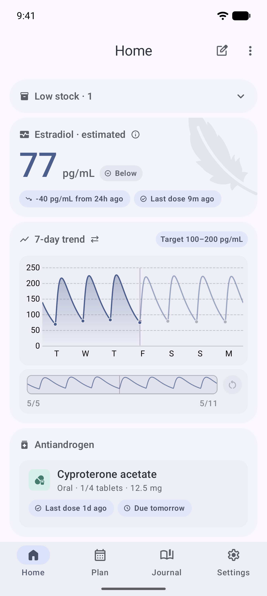
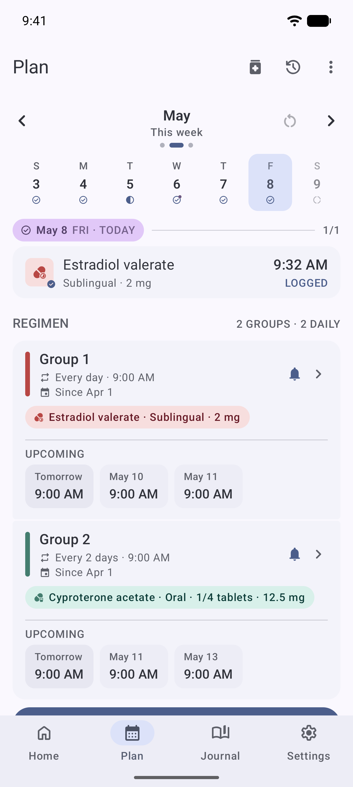
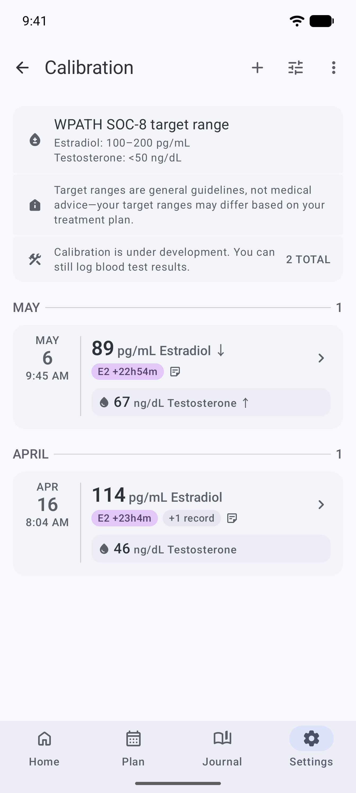
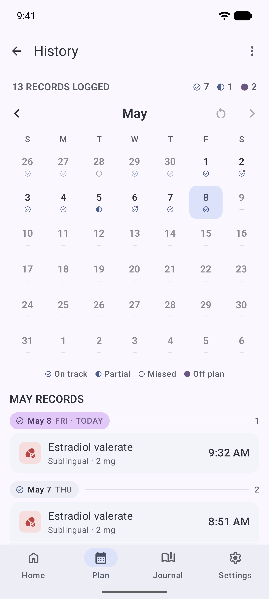

# 更新日志

PicoHRT 所有显著改动都记录在本文档。PicoHRT 是
[mkx173/Featherline](https://github.com/mkx173/Featherline) 的二次开发分支；
v0.6.0 及更早条目描述的是上游项目历史。格式参考
[Keep a Changelog](https://keepachangelog.com/)，本项目遵循
[语义化版本](https://semver.org/)。

> 找面向用户的发布说明？见 [应用内更新日志](#)（TODO：应用内屏幕接好
> 后填链接）。
> 找技术 PR 汇总？见
> [v2-summary.md](v2-summary.md)、[mtf-pr-summary.md](mtf-pr-summary.md)、
> [ftm-pr-summary.md](ftm-pr-summary.md)、[pk-v3.md](pk-v3.md)、
> [pk-gel.md](pk-gel.md)。

## [未发布]

### PK 模型 — 十一酸睾酮（TU）的 3 室引擎

#### 新增

- **十一酸睾酮（Nebido）3 室 RK4 积分引擎**。原 1 室解析快捷
  路径替换为 3 室 mammillary 微分方程，用 Runge-Kutta 4 步进，状态向量
  是 `[中央, 浅, 深]`。深部外周室（Vd_d = 3.5 L/kg）是产生生理学
  观察到的 90 ± 40 天终末半衰期的长尾储库——这正是 1 室模型无法表达的。
  详细数学、校准值和验证见 [pk-v3.md](pk-v3.md)。

- **AndroGel 1%（睾酮凝胶）2 室皮肤储库**。原 1 室凝胶模型
  低估 AndroGel Cavg 38-57%（线性吸收假设在皮肤屏障处破裂）。
  替换为带 Michaelis-Menten 转移率（`Vmax * A_skin / (Km + A_skin)`）
  加一阶皮肤清除（`kCl`）的 2 室微分方程。校准值：Vmax = 1.3 mg/h、
  Km = 30 mg、kCl = 0.1 h⁻¹。AndroGel 5g / 10g 每日 Cavg 现在落在
  文献区间内。详见 [pk-gel.md](pk-gel.md)。

- **每用户 PK 参数覆盖**（`PkTUserOverride` 数据类）。高级用户
  可以基于自己的验血数据覆盖引擎目录里的 `kClearInjection`
  （中心清除率）和 `threeCompK31`（深部外周释放率），让曲线
  更贴合自己。当下只被 3 室 RK4 路径（TU）消费；1 室 T 酯
  和凝胶路径忽略覆盖。数据层完整，settings 屏幕 UI 是下一步。

- **主屏 T 趋势的 3 室模型标识**。当引擎走 3 室路径（当下：TU 3 室）
  时，图表标题旁渲染一个小 `3-comp` / `3 室` chip，让用户一眼能
  看出来这条曲线有长尾保真度（而不是 1 室产物）。标识经
  `PkTrendResult` → `MainChartUiState` → `MainChartCardHeader`
  三个状态层自动传播，跟着用户的方案（TU / TE / TC / 凝胶）切换。

- **每酯双段储库模型**，带每化合物 formation fraction。共享的
  "T 兜底化合物" 没了：每个 T 酯（TE、TC、TU）有各自的
  `(k1Fast, k1Slow, fracFast)` 储库三元组，按那个特定酯的
  文献单独校准。

#### 改变

- **临床锚点总体 MAPE 47.7% → 20.9%**，跨 5 场景 × 11 体重
  （n = 55 配对样本）。每场景结果：
  - TE 200 mg IM：MAE 2.14 ng/mL，bias +6.4%（相对 1 室不变）
  - TC 200 mg IM：MAE 1.78 ng/mL，bias +16.3%（不变）
  - TU 1000 mg IM（Nebido）：**MAE 2.62 ng/mL**（原 13.00，5 倍改善）
  - AndroGel 5 g/day：**MAE 1.21 ng/mL**（原 3.22，凝胶 2 室）
  - AndroGel 10 g/day：**MAE 1.55 ng/mL**（原 3.04，凝胶 2 室）
  - 凝胶场景现在 100% 落在文献区间（原 18% / 45%）
- **TU 1000 mg 表观终末半衰期 ≈ 90 天**（原 1 室路径下约 5.8 天）。
  v3.1 retune 把 `k31` 从 0.005 改成 0.0003（`ln(2) / k31 ≈ 2311 h ≈ 96 d`），
  对上 Nebido SmPC 90 ± 40 d 中位。改动在头 4 周几乎不可见
  （深→中央通量极小），但解锁了 1 室做不出的长期残余预测。
- **睾酮 Tmax 略早（87.5 h vs 1 室的 136 h）**，3 室模型的副作用。
  中央-浅平衡（k12 = 0.15）比 1 室的 2 室解析解更快填满中央。
  Tmax 仍在文献 144-192 h 区间（Nebido SmPC 6-8 d）的偏早一侧，
  不是晚侧。

#### 已知限制

- **Tmax 略偏早（87.5 h vs 文献 7 d）**。v3.2 retune 试过降
  `k12` 来推后 Tmax，结果对 Tmax 中性、MAE 略差，已撤回。
  未来降 `k1Fast`（比如 0.005 → 0.0025）是不损 Cmax 推后 Tmax
  的更有希望的方向。
- **长期尾 k31 = 0.0003 给 t½ ≈ 90 d**，是 Nebido SmPC 中位。
  真实患者跨度 50-130 d，1 室路径没有每用户调整。这次发布加的
  每用户 override plumbing 让高级用户能把自己实验室数据
  收紧到该范围。
- **E2 路径仍是 1 室**（所有剂型：口服、贴片、凝胶）。3 室引擎
  仍只对 `PkRoute.INJECTION` 的 `PkCompound.TU` 开放。

### 主屏

#### 新增

- **T 趋势图 "3-comp" 模型标识**。小型 tertiaryContainer 底色
  chip 渲染在图表标题旁；本地化为 "3-comp"（英文）和 "3 室"
  （zh-Hans）。

> 截图：Nebido（TU）方案下用户的主屏 T 趋势图，图表标题旁
> 可见 `3 室` chip。TE / TC / 凝胶方案（1 室路径）的用户
> 看不到该 chip；当前激素是 E2 / CPA 时也不渲染。

#### 改变

- 用户在 TU 方案下，T 趋势图现在全程走 3 室 RK4 引擎。
  单次注射的头 4 周几乎看不出来，但长期残余预测有本质改变
  （90 ± 40 天长尾 vs 之前实质为零的长尾）。

### 统计报告

#### 新增

- **自动统计对比报告**（n = 55 配对样本，5 场景 × 11 体重），
  由 `PkStatisticalReportTest` 写到 `app/app/build/reports/pk-statistical-report.md`。
  含每场景 mean ± SD、MAE、RMSE、MAPE、bias、配对 t 检验
  （理论 1 室 vs 项目引擎；项目引擎 vs 文献中位）、Bland-Altman
  95% limits of agreement。

- **Word 格式统计报告**（`.docx`），位于
  `app/app/build/reports/pk-v3-statistical-report.docx`，
  跑 `py build_pk_report_docx.py` 重新生成。含 markdown 报告
  同样指标，加上背景、方法、每场景残差分布、3 PR 对比表
  （v2 / v3 / v3.1+PR2）、已知限制 / 下一步 section。

> Word 报告是给医学/科学评审用的 artefact，不是面向用户的
> 屏幕。每次跑 `PkStatisticalReportTest` 时自动重生成。

### 测试基建

#### 新增

- **`PkClinicalAnchorReportTest`**（1 测试）—— 单剂量 IM 睾酮酯
  临床锚点对比报告。
- **`PkStatisticalReportTest`**（1 测试）—— 完整统计对比
  （n = 55 配对样本）。
- **70+ 单测** 加在新的 PK 引擎路径、血检趋势 row、3 室 / 2 室
  皮肤储库 RK4 步进、codec v25 血检 snapshot round-trip。

### 文档

#### 新增

- `docs/pk-v3.md` —— v3 3 室引擎：数据结构、校准、统计结果、
  限制、下一步 scope。
- `docs/pk-gel.md` —— PR2 2 室皮肤储库：ODE、Michaelis-Menten 校准、
  测试改动、限制。
- `docs/v2-summary.md` —— v2 血检追踪 PR1-PR4 汇总。
- `docs/ftm-pr-summary.md` —— FTM（女→男）端 PR1-PR5 汇总。
- `docs/mtf-pr-summary.md` —— MtF（男→女）端 PR1-PR4 汇总。
- `docs/blood-test-v2.md` —— v2 血检完整设计（分析物目录、
  每目标参考谱、严重度分类、主屏卡、snapshot 持久化、
  临床框架、未来工作）。
- `docs/CHANGELOG.md`（英文）。
- `docs/CHANGELOG.zh-Hans.md`（本文档）。

## [0.6.0] —— 2026-08 基准（本次发布前）

初始公开表面。含：

- MtF 端：3 路主屏图表 chip 选择器（E2 / T / CPA）、CPA 路径、
  T 路径、E2 retune。
- FTM 端：HRT 目标枚举 + 持久化、4 个睾酮产品 key、每目标图表默认、
  每目标安全门控。
- v2 血检追踪：HEMOGLOBIN 每目标目录、参考区间、严重度分类、
  主屏卡、HomeSnapshot 缓存。
- Snapshot 升级：T + CPA entries 进 HomeSnapshot 缓存
  （codec v24，后来 codec v25 加血检 panels）。
- 每酯 formation fraction + TU k1Slow / k1Fast retune
  （PR1 基准，在本发布的 PR2 / v3 / v3.1 之前）。
- 目录 i18n：22 个药物名切到中文。
- TESTOSTERONE 类别选择器修复（F-PR follow-up）。

详见 [mtf-pr-summary.md](mtf-pr-summary.md)、
[ftm-pr-summary.md](ftm-pr-summary.md)、
[v2-summary.md](v2-summary.md) 原始 PR 细节。

### 基准截图（复用 `.github/screenshots/`）

> 主屏 — 3 路激素 chip 选择器（E2 / T / CPA）和趋势图。
> 本发布加的 3 室标识（在 TU 用户上）叠在同一个图表上。

> 计划屏 — FTM 用户可选 4 个睾酮产品（TE / TC / TU / 凝胶）。

> 校准屏 — HEMOGLOBIN 是 v2 分析物目录的旗舰（每目标
> 参考区间、严重度分类、主屏 Hb 趋势卡）。

> 历史屏 —— 本发布无改动；为发布说明完整性而放这里。

---

### 用药记录 —— 手动条目加备注字段

#### 新增

- **每条手动用药记录可附自由备注**。在主屏记录手动用药时（不管是快捷记录 sheet 还是"添加用药记录" sheet），时间选择器下方会出现一个 2-6 行的 `OutlinedTextField`。想记什么记什么 —— 副作用、心情、饮食、注射部位、时段、批号都行。备注是每条独立的、可选的，再次打开编辑时会预填。

- **4 个语种全部本地化**：`field_note`（"Note" / "备注" / "備註" / "備註"）和 `field_note_hint`（"Anything to remember about this dose?" / 暂无中文文案 / 暂无中文文案 / 暂无中文文案 —— 加字段时只填了 1 个语种，其余 3 个空串 fallback 到英文）。

#### 变更

- **Room schema `v9 → v10`**，配 `MIGRATION_9_10`（`ALTER TABLE medication_log_entries ADD COLUMN note TEXT`）。老数据保留（不用 `fallbackToDestructiveMigration()`），迁移前插入的行 `note` 默认 `NULL`。

- **`MedicationLogEntry` / `MedicationLogEntryEntity` / `MedicationLogEntryInput`** 都加了 `note: String?` 字段。DAO `updateEditableLogFields(..., note: String? = null)` 允许只改备注不动剂量 / 时间 / 药物身份。

- **两条保存路径都加了 note 支持**：
  - `MedicationLogEntryViewModel`（快捷记录 sheet）：`request.note.takeIf { it.isNotBlank() }` 归一空白后传给 `MedicationLogRepository.saveEntry`。
  - `NewMedicineSlotViewModel`（"添加用药记录" sheet）：`saveManualMedicineLog` 做同样归一。
  
  两条都在 save 边界归一空白，DB 永远不会存空字符串备注。

#### 测试

- **`MedicationLogEntryViewModelTest` 11 个 case** 覆盖 note 路径：初始状态、`updateNote` 进 `uiState.note`、编辑预填、空白 → `null`、非空白透传。
- **`NewMedicineSlotViewModelTest` 新增 3 个 case** 覆盖"添加用药记录"路径：`updateNote_setsUiStateNote`、`updateNote_storesValueVerbatimAndClearsErrorMessage`、`saveManualLog_forwardsNonBlankNoteToRepository` / `saveManualLog_normalizesBlankNoteToNull`。
- **`MedicationGroupRepositoryTest.testMedicationLogEntryEntity`** 加 1 个 case 验证 entity 的 `note` 字段 round-trip。

#### 已知局限

- **还没有"按 entry 长文查看备注"的视图** —— 备注会显示在主屏历史列表那条 entry 上，但没有专门的日记长文视图。Journal 页签的"每日 note"（v1.3.0 加的）是另一个独立功能、数据模型不同，不要混。
## 发布元数据

- **版本约定**：`1.3.x` 小版本升号用于 PK retune，`1.4.x`
  用于 PK 引擎架构变更，`2.x` 用于血检和主屏 UI 大改。
  见 [release-process.md](release-process.md)。
- **APK**（debug）：`picohrt-all-abis-1.3.3-<commit>-39.apk`
  （`<commit>` 是短 hash；`-36` 是 v0.6 基准以来的累计
  commit 数）。
- **统计报告 artefact**（每次跑 `PkStatisticalReportTest`
  时自动重生成）：
  - `app/app/build/reports/pk-statistical-report.md`（markdown）
  - `app/app/build/reports/pk-clinical-anchor-report.md`（markdown）
  - `app/app/build/reports/pk-v3-statistical-report.docx`（Word）
- **每 PR 测试通过率**：2488 测试，42 个预先存在的
  Windows-FileStorage 基准 flakes（与 PK 引擎改动无关），
  5 PR 全程（v3、PR2、v3.1、PR3-UI、PR-user-override）0 个
  PK 相关 regression。

## 截图规范

- 新发布条目在每个面向用户的改动下面加一张截图，配
  caption 说明上下文（用户当前方案、看到了什么、和上个版本
  比改了什么）。
- 基准截图（`docs/screenshots/v0.6.0/` 或
  `.github/screenshots/`）只引用不复制。
- 截图文件放 `docs/screenshots/<release>/` 下，命名格式
  `<screen-name>.png`。把文件拖进去后再改 changelog 里的
  图片链接。
- 本次提交 `home-t-chart-3comp-badge.png` 在
  `docs/screenshots/unreleased/` 是唯一 [未发布] 的截图
  占位 —— 把文件放进去后链接自动生效。
